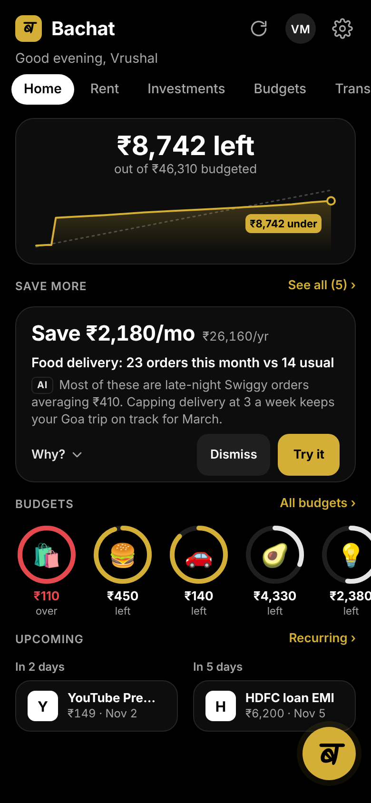
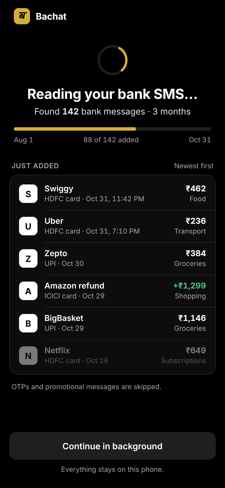
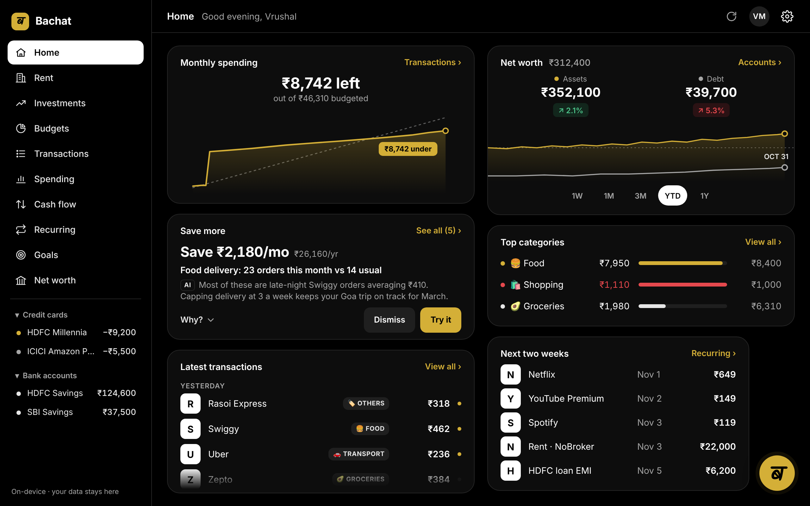
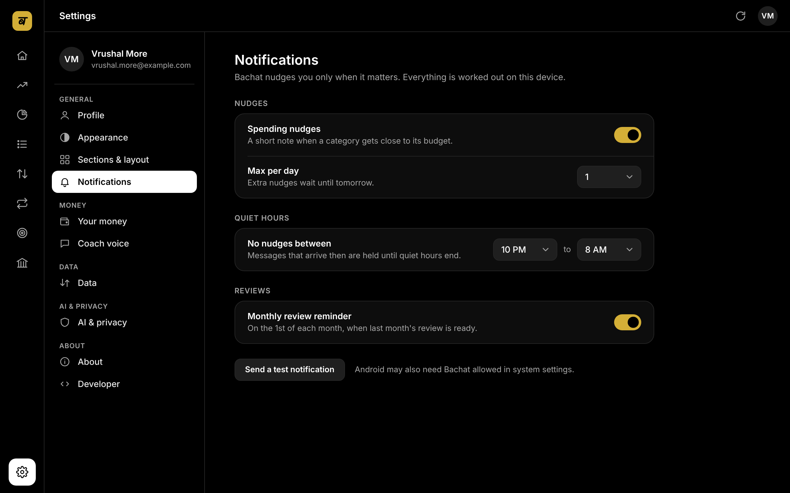
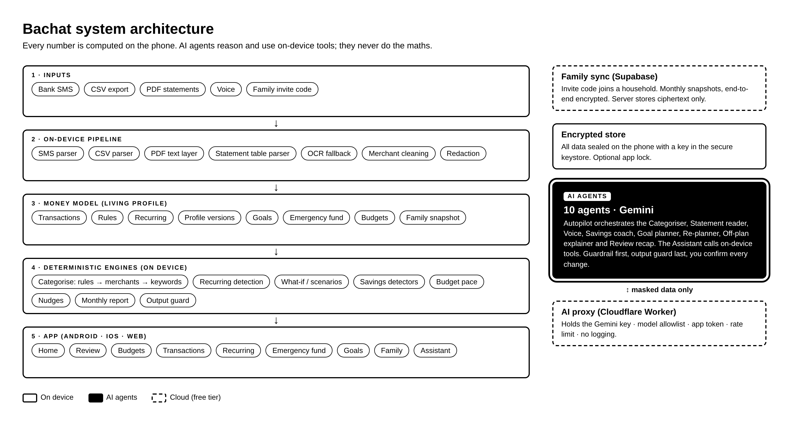

<div align="center">


**A privacy-first personal finance coach that turns bank SMS, CSVs and PDF statements into a living money model, and a team of AI agents that reason, use tools and act.**

[](https://docs.expo.dev/)
[](https://reactnative.dev/)
[](https://www.typescriptlang.org/)
[](https://ai.google.dev/)
[](LICENSE)
[](#contributing)

### [📲 Download the Android app (APK)](https://drive.google.com/file/d/1a9uc-C8i5a4FA89IPfm3UW2ochXryBOY/view?usp=sharing)

[Features](#features) · [Screenshots](#screenshots) · [Architecture](#architecture) · [AI agents](#how-the-ai-agents-work) · [Privacy](#privacy--security) · [Download](#download) · [Quick start](#quick-start) · [Roadmap](#roadmap)

</div>

---

## Why Bachat

**The problem.** Your money story is scattered across bank SMS, card statements and UPI apps. Budget apps want manual entry. Chatbots guess numbers. Nobody tells you, in plain words, *where the money went and what to change*.

**Who it's for.** Young salaried professionals in Indian metros, 22–30: first or second job, rent, a few subscriptions, a goal or two (a trip, a bike, an emergency fund), and no time for spreadsheets.

**What Bachat does.**
- Reads your bank SMS and statements, sorts every rupee, and learns from your corrections.
- Keeps a living money model: income, fixed costs, goals, emergency fund, versioned over time.
- Finds real savings and warns you early. Every number is computed on the phone.
- An AI agent reasons over that model with on-device tools. It explains; it never invents numbers.
- Shares a merged view with family, end-to-end encrypted.

> Educational information only, not financial advice. Bachat never recommends specific stocks or funds.

## Features

| Capability | How Bachat does it | Where |
|---|---|---|
| **Ingest SMS, CSV and PDF** | Parsers for bank/card SMS, CSV exports and PDF statements (text layer → table parser → OCR fallback). | Transactions → Add transactions · Settings → Import |
| **Automatic categorisation** | Your rules → merchant list → keywords → AI with your own examples. Each row shows *why* and *how sure*. | Transactions |
| **Learns from corrections** | Fix one row → "Always categorise X as Y?" → rule applied to past and future rows, with Undo. | Transactions · Settings → Rules |
| **Recurring + alerts** | Detects subscriptions and EMIs; flags price hikes (+₹/yr), trial → paid, missed and unused ones. | Recurring · Home |
| **Persistent profile** | Income, fixed costs, emergency fund, goals with dates. Every save is versioned. | Onboarding · Settings → Your money · Goals |
| **Goal planner + what-if** | "What if I cut dining out by 30% and rent goes up ₹5,000?" → before/after for every goal. | Assistant · Goals |
| **Save more** | Detectors for overlapping subscriptions, delivery habits, spikes, small frequent spends, fees, cabs. AI ranks and explains. | Home → Save more |
| **Nudges + monthly review** | Pace vs plan per category, max one nudge a day, quiet hours. One-page monthly report with PDF export. | Home · Review · Settings → Monthly review |
| **Family** | Invite by code, merged totals, shared goals and budgets, duplicate subscriptions across the household. E2E encrypted sync. | Family · Settings → Family |
| **Agentic AI** | Gemini with function calling over on-device tools, autopilot after every refresh, writes only after you confirm. | Assistant (ब button) · Home |

Also: budgets, spending, cash flow, rent, investments overview, net worth, voice input, light/dark themes, a hide-amounts switch, and a laptop layout with a sidebar.

## Screenshots

<table>
  <tr>
    <td align="center"><br><sub>Home</sub></td>
    <td align="center"><br><sub>Save more</sub></td>
    <td align="center"><br><sub>Reading bank SMS</sub></td>
    <td align="center"><br><sub>Monthly review</sub></td>
  </tr>
</table>

<table>
  <tr>
    <td align="center"><br><sub>Home · laptop</sub></td>
    <td align="center"><br><sub>Settings · laptop</sub></td>
  </tr>
</table>

## Architecture

One Expo codebase runs on Android, iOS and the web. The design rule: **maths does every number, AI only decides and phrases.**



| Layer | What lives there | Code |
|---|---|---|
| Inputs | Bank SMS, CSV, PDF statements, voice, family invite codes | `src/services/ingest.ts`, `src/services/smsReader.ts` |
| On-device pipeline | SMS/CSV/PDF parsers, PDF text layer, statement table parser, cleaning, redaction | `src/engine/{sms,csv,pdf,pdfText,statementTable,clean,merchant}.ts`, `src/services/redact.ts` |
| Money model | Transactions, rules, recurring, profile versions, goals, budgets, family | `src/data/{store,types,categories}.ts` |
| Deterministic engines | Categorise, recurring, what-if, savings, budgets, nudges, report, output guard | `src/engine/*` |
| AI agent | Gemini calls, function calling, tools, autopilot | `src/services/{gemini,geminiTools,agent,agentTools,autopilot}.ts` |
| UI | Screens (expo-router) and shared kit | `src/app/*`, `src/shell/*`, `src/ui/*` |

## How the AI agents work

Every AI task has its own agent: its own role, rules and temperature. All agents share one Gemini API through the proxy, with the same redaction and guards. Their last run shows in **Settings → AI**.

| Agent | Job |
|---|---|
| Categoriser | Sorts unclear transactions using your past corrections |
| Statement reader | Reads messy bank statements |
| Voice | Turns speech into a request |
| Savings coach | Finds where you can save more |
| Goal planner | Turns goals into 2–3 concrete moves |
| Re-planner | Understands life changes ("what if…") |
| Off-plan explainer | Explains why you are going off plan |
| Review recap | Writes the day / week / month / year recap |
| Assistant | Answers questions using the app's tools |
| Autopilot | Runs the other agents after each refresh |

The Assistant agent follows **reason → use tools → act**:

1. **Guardrail first.** Requests for stock or fund picks are refused with a short lesson and a pointer to a SEBI-registered adviser.
2. **Router.** Common questions ("How much did I spend on food?") take a fast deterministic path. It works offline and when the AI is busy.
3. **Agent loop.** Open or multi-step asks ("Can I afford a Goa trip in March and keep my emergency fund?") go to Gemini with function declarations. Gemini picks a tool, the tool runs **on the device** with validated arguments, the result goes back. At most 5 steps.
4. **Output guard.** Every number in the final text must match a number a tool returned. If not, the app falls back to its basic answer.
5. **Act with consent.** Write tools (add goal, set budget, add rule, apply life change, mark subscription) only *propose*. You see one Confirm / Cancel row; after Confirm a snackbar offers Undo.

| Tools | |
|---|---|
| Read | `get_overview` · `get_spending` · `get_recurring` · `get_goals` · `get_profile_summary` · `get_save_more_ideas` · `run_what_if` · `get_family_summary` |
| Write (proposals) | `add_goal` · `set_budget` · `add_rule` · `apply_life_change` · `mark_subscription` |

**Autopilot.** After every refresh or import, the agent works on its own, within safe limits: it sorts low-confidence rows using your past corrections, refreshes recurring and alerts, recomputes Save more, re-checks goal plans and sends at most the allowed nudges. Anything that changes your budgets, goals or profile becomes a suggestion. You see one line, e.g. *"Autopilot: sorted 6 · 2 ideas"*.

## Privacy & security

Privacy is the product, not a setting.

- **Maths on device.** Parsing, categorising, recurring detection, what-if and savings all run locally.
- **AI sees redacted text.** Card and account numbers, UPI IDs, phone numbers, emails, PAN, Aadhaar, IFSC, OTPs and reference numbers are masked before any AI call. Merchant names and amounts stay, because the answer needs them.
- **Imported text is data, not instructions.** SMS, CSV and PDF text sent to the AI is wrapped and labelled, and AI output is schema-checked or guarded.
- **Encrypted local storage.** Saved state is sealed with a random 32-byte key kept in the phone's secure keystore. Optional app lock (biometric or device PIN). On web, storage falls back to plain browser storage.
- **No key in the app.** In production the Gemini key lives in a Cloudflare Worker proxy with a model allowlist, app token, CORS allowlist, rate limit and no body logging.
- **Family sync is end-to-end encrypted.** Snapshots are encrypted on the phone with the household secret; the server stores ciphertext only. Raw SMS is never shared.

Threat model and how to report a vulnerability: [SECURITY.md](SECURITY.md).

## Download

| Device | How to get Bachat |
|---|---|
| **Android phone** | [Download the APK](https://drive.google.com/file/d/1a9uc-C8i5a4FA89IPfm3UW2ochXryBOY/view?usp=sharing) (or from this repository's **Releases** page), open it, and allow *Install unknown apps* when asked. |
| **Laptop / desktop** | Open the web app from this repository's **GitHub Pages** link (top right, under *About*). Works in any modern browser. |
| **Developers** | Clone the repo and follow [Quick start](#quick-start) to run it in Expo Go. |

### Build it yourself

Both builds run free on GitHub Actions, so no Android Studio is needed:

1. **Settings → Secrets and variables → Actions:** add `EXPO_PUBLIC_AI_PROXY_URL`, plus the Supabase values if you use family sync.
2. **Android APK:** *Actions → Android APK → Run workflow.* The APK appears under the run's *Artifacts* in about 15 minutes. Push a tag such as `v1.0.0` and it is also attached to a Release.
3. **Web app:** *Settings → Pages → Source: GitHub Actions*, then every push to `main` publishes the site.

> Anything in an `EXPO_PUBLIC_` variable is built into the app. Use the AI proxy for public builds, never your Gemini key.

## Quick start

**Needs:** [Node.js LTS](https://nodejs.org) and [Expo Go](https://expo.dev/go) on your phone.

```bash
npm install
cp .env.example .env      # optional: add AI and family sync settings
npx expo start
```

- **Phone:** scan the QR code with Expo Go (same Wi-Fi). On office or college networks use `npx expo start --tunnel`.
- **Laptop:** press **w** in the terminal to open the web version with the sidebar layout.
- **First launch:** answer six quick questions, or tap **Try with demo data** for three months of realistic transactions and a demo family.

Bachat works without any keys. AI features fall back to built-in wording, and Family runs in local demo mode.

### Environment variables

| Variable | Purpose |
|---|---|
| `EXPO_PUBLIC_AI_PROXY_URL` | URL of your deployed AI proxy. When set, all AI calls go here and no key is sent. **Use this in production.** |
| `EXPO_PUBLIC_AI_APP_TOKEN` | Optional shared token the proxy checks (`x-app-token`). |
| `EXPO_PUBLIC_GEMINI_API_KEY` | **Dev only.** Direct Gemini key for local testing. `EXPO_PUBLIC_` values are bundled into the app, so never ship a real key this way. |
| `EXPO_PUBLIC_GEMINI_MODEL` | Optional model override (default `gemini-flash-latest`). |
| `EXPO_PUBLIC_SUPABASE_URL` | Supabase project URL for family sync. |
| `EXPO_PUBLIC_SUPABASE_ANON_KEY` | Supabase anon (public) key. Row-level security protects the data. |

### Limits in Expo Go

- Reading the real SMS inbox needs a custom Android build with an SMS reader module (`READ_SMS` is declared in `app.json`). In Expo Go, **Read bank SMS** imports a built-in sample inbox through the same parser. You can always paste SMS or upload a statement.
- Password-protected PDFs: remove the password first.

## Deploy the AI proxy

The proxy is a free Cloudflare Worker in [`worker/`](worker/). It holds the Gemini key as a secret and only forwards `POST /v1/generate`.

```bash
cd worker
npx wrangler login
npx wrangler secret put GEMINI_API_KEY      # paste your key from aistudio.google.com/apikey
npx wrangler deploy
```

Then set `EXPO_PUBLIC_AI_PROXY_URL` to the deployed URL (and `EXPO_PUBLIC_AI_APP_TOKEN` if you configured one). Allowed origins and limits are set in `worker/wrangler.toml`.

## Family sync setup

Family sync uses the Supabase free tier. The server only ever stores ciphertext.

1. Create a project at [supabase.com](https://supabase.com).
2. In **SQL Editor**, run [`supabase/schema.sql`](supabase/schema.sql). It creates the `members` and `snapshots` tables with row-level security.
3. In **Authentication → Sign In / Providers**, enable **Anonymous sign-ins**.
4. Copy the project URL and anon key into `.env` as `EXPO_PUBLIC_SUPABASE_URL` and `EXPO_PUBLIC_SUPABASE_ANON_KEY`.
5. Restart `npx expo start`. Settings → Family now shows sync on. Invite with a code like `BACHAT-XXXX-XXXX-XXXX`.

## Project structure

```
bachat-expo/
├── .github/workflows/  # Free cloud builds: Android APK + web app (GitHub Pages)
├── src/
│   ├── app/            # Screens (expo-router): Home, Review, Budgets, Transactions,
│   │                   #   Spending, Cash flow, Rent, Recurring, Emergency fund,
│   │                   #   Goals, Investments, Net worth, Family
│   ├── data/           # Store (zustand, persisted), types, categories, demo data
│   ├── engine/         # Pure TypeScript: parsers, categorise, recurring, what-if,
│   │                   #   savings, budgets, nudges, report, output guard
│   ├── services/       # Gemini, agent + tools, autopilot, ingest, SMS reader,
│   │                   #   redaction, secure storage, family + sync, coaches
│   ├── shell/          # App shell: Home parts, Assistant, Save more, import,
│   │                   #   onboarding, settings pages, app lock
│   ├── theme/          # Theme tokens, money formatting
│   └── ui/             # Shared kit, charts, snackbar, settings rows
├── worker/             # Cloudflare Worker AI proxy
├── supabase/           # schema.sql for family sync
├── docs/               # README images and their HTML sources (docs/src)
├── SECURITY.md
├── .env.example
└── app.json
```

## Tech stack

| Area | Choice |
|---|---|
| App | Expo SDK 58, React Native 0.88, React 19, expo-router |
| Language | TypeScript (strict) |
| State | zustand with encrypted persistence |
| Crypto | tweetnacl (secretbox), expo-crypto, expo-secure-store |
| AI | Google Gemini with function calling, via a Cloudflare Worker proxy |
| Sync | Supabase (anonymous auth, row-level security, ciphertext only) |
| Files | expo-document-picker, papaparse, pdf.js in a locked-down WebView |
| Device | expo-notifications, expo-local-authentication, expo-audio, expo-print, expo-sharing |

## Roadmap

- [ ] Android release build with real SMS inbox reading and new-SMS listening
- [ ] Account Aggregator (RBI AA framework) for consented bank data
- [ ] On-device model for categorising without any network call
- [ ] Hindi and regional-language UI and voice
- [ ] Bill reminders from statements and e-mail receipts
- [ ] Shared family goals with automatic monthly splits
- [ ] Home-screen widget for "left to spend"

## Contributing

PRs are welcome.

1. Fork and create a branch: `git checkout -b feat/short-name`.
2. Keep the design rule: **maths computes every number; AI only decides and phrases.** Any AI text with numbers must pass `guardOutput`.
3. Keep it strict-TypeScript clean (`npm run typecheck`) and web-safe (guard native-only modules).
4. Never log user data, never send unredacted text to an AI, and never recommend specific securities.
5. Open a PR with a short description and a screenshot for UI changes.

Found a security issue? Please follow [SECURITY.md](SECURITY.md) instead of opening a public issue.

## License

[MIT](LICENSE)

## Acknowledgements

<!-- credits to be added -->
